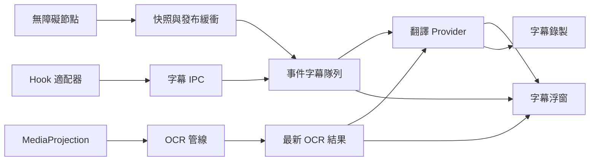

# 架構與資料流

對應 1.0.6，核對日期為 2026-10-30，含第三方 Hook v2／無障礙 v1 適配接口。類別及欄位以源碼為準，建置與測試方式見[開發文件](development.md)。

## 模組與責任

| 位置 | 責任 |
| --- | --- |
| `app/.../app` | Activity、Compose 主介面、App 可見性與工作階段入口 |
| `capture` | 前景服務、MediaProjection、暫停／停止、字幕隊列與結果分派 |
| `ocr` | 模型、Latin／中文／日文／韓文辨識、穩定判斷與近似文字去重 |
| `accessibility` | 動態適配目錄、節點選取與快照、雙行合併、發布緩衝與權限狀態 |
| `hook` | 字幕及框架狀態接收、令牌、來源、Hook 目錄與作用域 |
| `translation` | Provider、請求排程、快取、限流、重試與串流 |
| `overlay` | 控制器、字幕、選區與位置保存 |
| `data` | 設定、私人 API 憑證與分區備份 |
| `feature` | 首頁、OCR、無障礙、Hook、翻譯、錄製、設定與權限頁 |
| `core` | 共用模型、語言、Material 3 主題、取色與導覽 |
| `hook/` 模組 | 注入目標 App，以內建或宣告式 runtime 適配器取得並傳送字幕 |

主程式套件為 `com.shiraka.screentranslator`，模組為 `com.shiraka.subtitlemodule`。模組不翻譯，也不建立浮窗。

## 擷取工作階段

`CaptureForegroundService` 管理四種模式。OCR 使用 `mediaProjection` 前景服務類型；事件字幕使用 `dataSync`。

手動暫停及螢幕／App 生命週期狀態共同決定有效暫停。OCR 暫停時停止圖片處理並取消在途辨識與翻譯；事件字幕暫停時不處理新的顯示更新，並取消在途翻譯。恢復不會重放暫停期間全部字幕。

停止會釋放擷取、翻譯執行器、浮窗及訂閱並結束錄製。Android 前景服務 timeout 會結束工作階段，需由使用者重新開始。

## OCR

`MediaProjectionController` 提供圖片，`OcrPipeline` 處理間隔、穩定程度、近似去重與 generation。`LatestRequestCoordinator` 及翻譯的 latest-request 路徑取消被新畫面取代的工作，避免過期結果覆蓋新畫面。

語言映射由 `TranslationLanguage.requiredOcrScripts()` 定義：英語／德語／法語使用 Latin；簡繁中文使用 Chinese；日語與韓語各有模型；自動偵測需要四組模型。辨識使用圖片副本，完成回呼後才回收，取消或 timeout 不立即回收仍被辨識器使用的副本。

## 無障礙字幕

`YoutubeSubtitleAccessibilityService` 保留已安裝服務的 component 名稱，依 `AccessibilityAdapterRepository` 已啟用條目動態訂閱套件，且只在 `AccessibilitySubtitleRepository.captureRequested` 為真時處理字幕；不啟動 MediaProjection，也不需要 OCR 模型。全部停用時以主程式自身作閒置 filter，不把空套件清單當成訂閱全部 App。

優先讀取已啟用套件的目前視窗，無法取得時沿事件來源祖先取得字幕樹。內建 YouTube 路徑同時搜尋已知 view ID 及字幕類別；第三方路徑套用 selector。多個字幕視窗依畫面位置排序。`YoutubeCaptionNodeSnapshot` 合併父、子節點的重複表示並保留不同文字，不只取最長節點。畫面兩行視為完整快照，不推測是否同一句。

`YoutubeCaptionBuffer` 合併逐步增加的字幕；相同文字的事件不重設等待。下一句取代未發布內容時，先送出前一份快照。補掃延遲為 120 ms；預設穩定等待 280 ms、清空延遲 900 ms，第三方可設定時間，同套件多條規則各取最大值。節點及文字上限見服務與 `YoutubeCaptionPolicy.kt`。

事件帶 session、sequence 與 capture generation，轉入共用事件字幕路徑。無障礙與 Hook 共用多條保留、多來源翻譯及錄製。

第三方無障礙規則以 `viewId`／class 精確或 substring 條件選中可見節點，按設定讀取文字／描述及子樹，沿用快照合併與發布緩衝。套件切換及規則變更會清除前一來源的 pending caption。內建 YouTube 仍使用原有 ID／類別啟發式。

## 第三方 Hook 規則

`HookCatalogRepository` 支援描述 v1 與包含 runtime 的 v2；匯入後先停用，內建條目不可覆寫。目錄變更透過同簽章狀態 Activity 傳送完整快照，由模組 `FrameworkStatusBridge` 寫入框架 Remote Preferences。接收端不固定列出兩個 App，而是以已啟用且可執行的目錄條目形成來源範圍。

各條目獨立保存 enabled，框架 getScope 不覆寫本機選擇；只有同套件最後一個條目停用時才請求移除作用域。首頁將目錄 enabled 與框架作用域交集作為 Hook 模式可用判斷，讓自訂適配可取代同套件的內建來源。

模組於 package-ready 呼叫 `DeclarativeHookAdapter`，在指定程序與 class loader 查找方法、依參數型別解析 overload，after 原方法成功執行後，以 `RuleTextExtractor` 有界遍歷欄位／集合提取 CharSequence。新增或修改規則需重啟目標 App；主程式的停用與移除檢查即時生效。格式細節與限制見[適配接口](adapters/README.md)。

主程式傳送的執行快照最多 200,000 UTF-8 bytes；模組框架斷線時最多保留 8 個待處理狀態請求。規則同步成功與作用域授權是分別核對的狀態，匯入成功不代表目標 App 已通過相容性驗證。

## 事件字幕隊列與計時

`HookSubtitleRecord` 保存來源、session、sequence、原文、各來源譯文、翻譯 job 與獨立 expiration job。

- `hookHistoryCount` 包含最新一條在內，上限 8 條，對 Hook 與無障礙都生效。
- 超過數量時淘汰最舊紀錄，取消該紀錄的翻譯與到期工作。
- `submitIndependent()` 為各紀錄建立獨立翻譯；新句不直接取消上一句。
- 回傳以來源套件、session、sequence 定位紀錄，不依列表位置。已移除紀錄的晚到結果被忽略。
- 自動隱藏時每條可見紀錄獨立計時；翻譯結果更新可重新計時。僅譯文模式取得可見譯文後才開始，時長限制 1–30 秒。
- 計時保留開啟時，來源清空不提前移除字幕；未開啟時，來源清空移除最新紀錄，見 `EventSubtitleRetentionPolicy`。
- 暫停保留各條既有 expiration job，沒有共用的全域清空計時器。

## 翻譯、錄製與保存

`TranslationSettingsRepository` 保存選擇與網路設定，憑證由 `SecureCredentialStore` 管理。`TranslationProviderFactory` 建立 Provider，`TranslationRepository` 處理快取、間隔、重試、健康狀態及串流。實際語言能力依各 Provider 而異。

`SubtitleRecordingRepository` 將時間軸寫入私有 `filesDir/subtitle-recordings/`，以暫存檔及替換方式保存。內容含原文、譯文、時間、模式、來源套件與 session。列表優先顯示已知或系統可解析的 App 名稱，否則回退包名；詳情可隱藏無譯文項目。

設定使用 SharedPreferences、DataStore 與 AppCompat 語言設定。`ConfigurationBackupRepository` 依明確分區匯出，不直接複製設定目錄；見[備份格式](backup-format.md)。

## 浮窗與介面

控制器及毛玻璃字幕使用獨立 overlay window。Android 12+ 在系統允許時使用跨視窗模糊，否則使用半透明漸層；效果受裝置合成器及系統設定影響。App 內玻璃導覽使用 Haze，與浮窗系統模糊是不同實作。

圓形按鈕在點擊修飾器前裁切，紋理限制在畫布內；不繪製矩形內縮白色高光。拖動／收合共用手勢入口，位置由 `OverlayStateRepository` 保存。

`Theme.kt` 使用系統動態色或種子色生成完整明暗配色；`HsvColorPicker` 提供色相、飽和度與明度。底部導覽按文字實際寬度選擇圖文或僅圖標，設定及錄製詳情使用水平子頁動畫。

作用域及通訊見 [Hook 文件](../hook/README.md)，信任邊界見[安全文件](security.md)。
